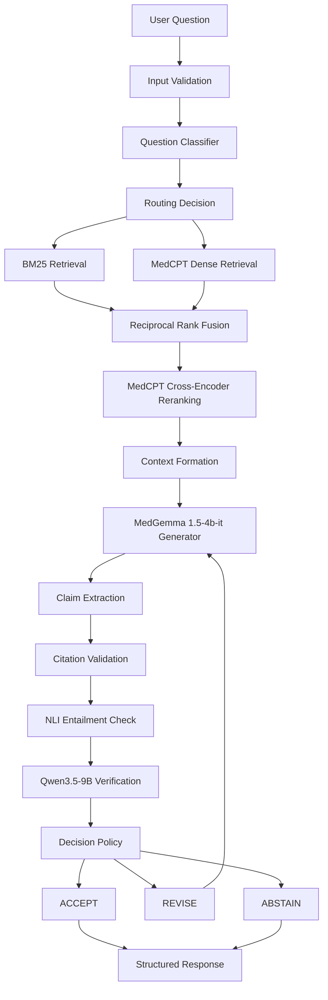
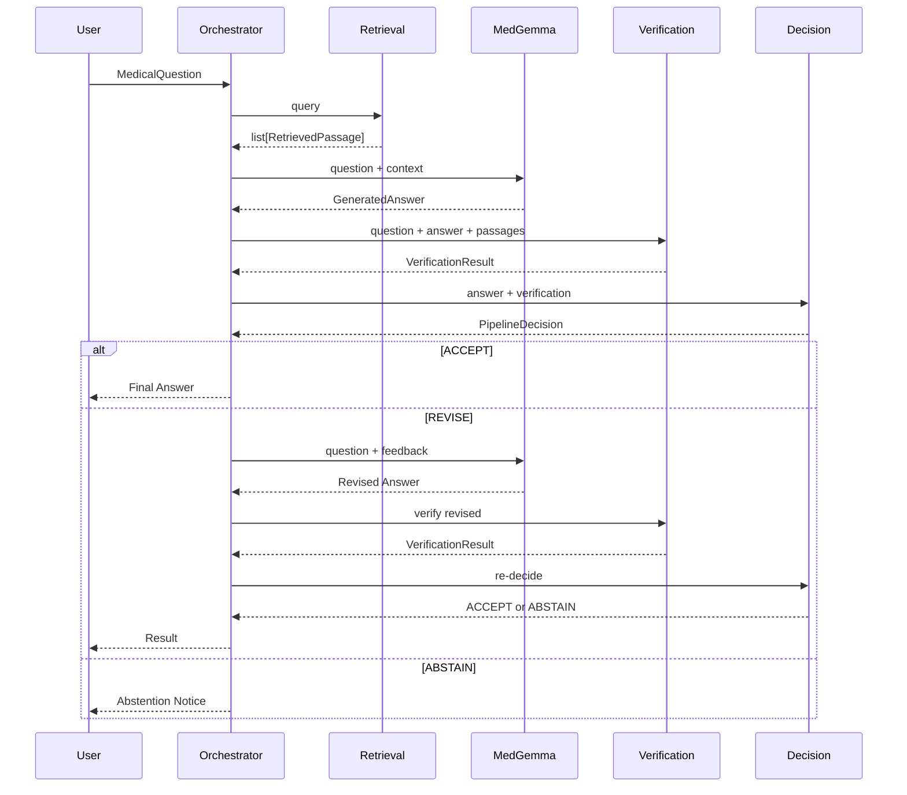

# MedFusion-RAFT System Architecture

## Overview

MedFusion-RAFT is a multi-model medical question-answering system that combines biomedical retrieval, parameter-efficient fine-tuning, and independent answer verification to produce reliable, evidence-grounded medical answers.

## Architecture Diagram



## Module Contracts

### 1. Retrieval Interface

```python
class RetrievalPipeline:
    def build_index(passages: list[Passage]) -> None
    def retrieve(query: str, top_k: int = 5) -> list[RetrievedPassage]
    def save_indices(directory: str) -> None
    def load_indices(directory: str) -> None
```

**Input**: Natural language medical question
**Output**: Ranked list of RetrievedPassage objects with:
- passage_id (stable identifier)
- text (passage content)
- score (relevance score)
- retrieval_method (bm25 | dense_medcpt | hybrid_rrf | reranked)
- metadata (document source, section, page)

### 2. Generator Interface

```python
class BaseGeneratorProvider:
    def load() -> None
    def generate_answer(question: str, context: str) -> GenerationOutput
    def unload() -> None
```

**Input**: Question + formatted evidence context
**Output**: GenerationOutput containing structured text with:
- ANSWER section
- CITATIONS list
- ANSWERABILITY label
- CONFIDENCE score

### 3. Verification Interface

```python
class VerificationPipeline:
    def verify(
        question: str,
        answer: GeneratedAnswer,
        passages: list[RetrievedPassage]
    ) -> VerificationResult
```

**Input**: Question, generated answer, evidence passages
**Output**: VerificationResult with:
- Per-claim support status (SUPPORTED | PARTIALLY_SUPPORTED | UNSUPPORTED | CONTRADICTED | INSUFFICIENT_EVIDENCE)
- Overall verification score
- Verification reasoning

### 4. Decision Interface

```python
class DecisionEngine:
    def decide(
        answer: GeneratedAnswer,
        verification: VerificationResult,
        num_evidence_passages: int,
        current_revision_count: int
    ) -> PipelineDecision
```

**Input**: Answer + verification result + evidence count
**Output**: PipelineDecision with:
- decision: ACCEPT | REVISE | ABSTAIN
- calibrated score
- reasoning

### 5. Orchestrator Interface

```python
class MedFusionOrchestrator:
    def process_question(question: MedicalQuestion) -> PipelineResult
    def process_batch(questions: list[MedicalQuestion]) -> list[PipelineResult]
```

## Data Flow



## Configuration Architecture

All components are configured via YAML files in `configs/`:

| Config File | Controls |
|-------------|----------|
| `models.yaml` | Model IDs, quantization, generation params |
| `training.yaml` | QLoRA, SFT, RAFT hyperparameters |
| `retrieval.yaml` | Chunking, BM25, dense, fusion, reranking |
| `verification.yaml` | Claim extraction, citations, entailment, abstention |
| `evaluation.yaml` | Metrics, statistical tests, performance |
| `experiments.yaml` | Experiment matrix (E1-E9) |

## Error Handling

| Failure | Behavior |
|---------|----------|
| Generator fails | Return ABSTAIN with error |
| Verifier fails | Return unverified answer with warning |
| Retrieval fails | Generate without evidence (if allowed) |
| OOM error | Unload models, clear cache, retry with reduced batch |
| Timeout | Return partial result or ABSTAIN |
| Model not accessible | Use mock provider, log warning |

## Model Independence

Each model has a distinct, non-overlapping responsibility:

1. **MedGemma** (Generator): Understands medical questions, interprets evidence, generates grounded answers
2. **Qwen3.5** (Verifier): Independently assesses answer quality, identifies unsupported claims
3. **MedCPT** (Retrieval): Encodes and retrieves biomedical evidence
4. **DeBERTa-v3** (NLI): Deterministic entailment checking for claim-evidence pairs

The verifier does NOT simply agree/disagree — it independently decomposes the answer and checks each claim against evidence. Deterministic citation and entailment checks complement the LLM verification.

